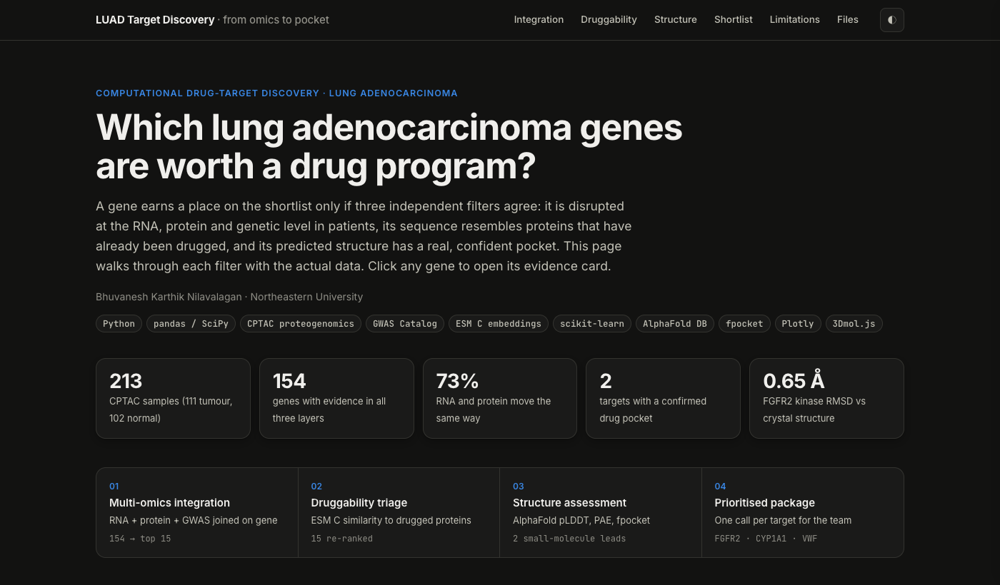
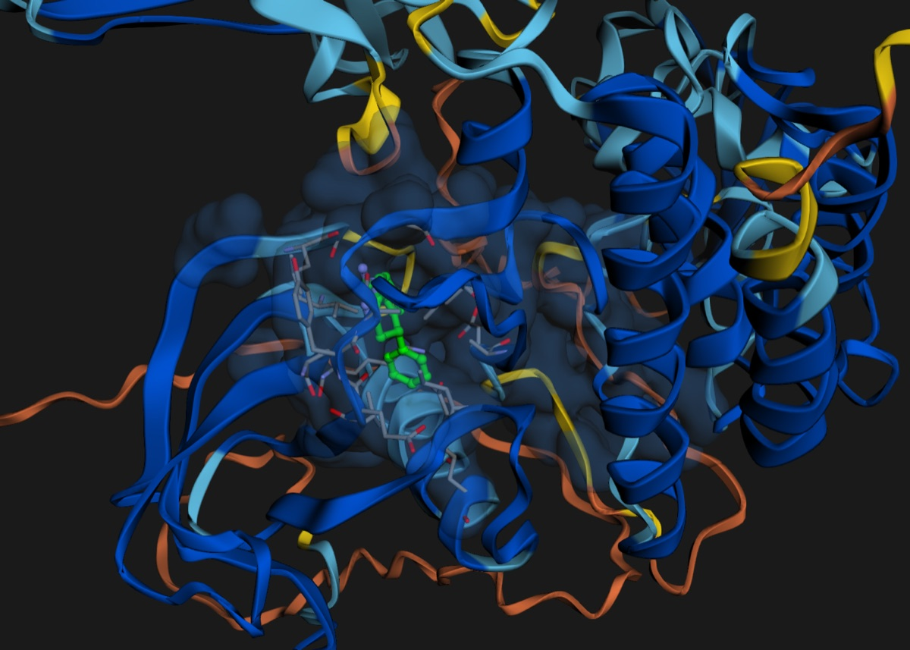
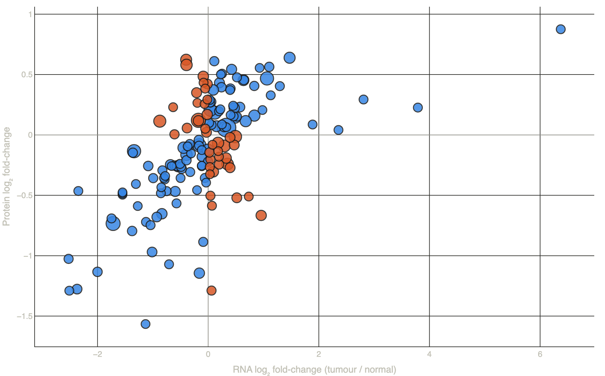

# LUAD Target Discovery: from patient omics to a druggable pocket

**[▶ Live interactive demo](https://bhuvaneshkarthiknilavalagan.github.io/luad-target-discovery/)**

A computational pipeline that asks which lung adenocarcinoma (LUAD) genes are worth a drug program. A gene makes the shortlist only if three independent filters agree:

1. **Patient evidence:** it is disrupted at the RNA, protein *and* genetic level.
2. **Tractability:** its sequence resembles proteins that have already been drugged.
3. **Structure:** its predicted 3D structure has a confident pocket where a drug can actually bind.



## Key results

| | |
|---|---|
| **154 genes** | had evidence in all three data layers (CPTAC RNA, CPTAC protein, GWAS) |
| **73 %** | showed matching RNA and protein changes; the other 27 % point to post-transcriptional regulation (e.g. BRCA2) |
| **FGFR2** | is the top target: strongest multi-omics evidence, nearest drugged relative FGFR1 (cosine 0.99), and a confident kinase pocket |
| **100 % / 94 %** | of the known crystal-ligand sites in FGFR2 (3RI1) and CYP1A1 (4I8V) were recovered by the best confidence-filtered pocket |
| **0.65 Å / 0.33 Å** | RMSD between the AlphaFold models and the experimental structures (confident residues) |

One check mattered most: FGFR2's second-best pocket by geometry sat in a low-confidence region (mean pLDDT 63) and was rejected. Geometry alone would have kept it.

<p align="center"><br>
<sub>FGFR2 AlphaFold model coloured by confidence. The inhibitor from crystal structure 3RI1 (green) is superposed into the predicted pocket (blue surface).</sub></p>

## Pipeline

| Step | What it does | Notebook |
|---|---|---|
| **1 · Multi-omics integration** | Tumour vs normal differential expression for RNA and protein (213 CPTAC samples), GWAS Catalog associations, harmonised on gene symbol and scored with equal weight per layer. Includes a sensitivity check on cross-cancer GWAS hits. | [`01_multiomics_integration`](notebooks/01_multiomics_integration.ipynb) |
| **2 · Tractability triage** | ESM C protein-language-model embeddings and logistic-regression priors for small-molecule and antibody tractability. Validated with **family-held-out** cross-validation to avoid homologue leakage, then blended 60 : 40 with the patient evidence. | [`02_tractability_triage`](notebooks/02_tractability_triage.ipynb) |
| **3 · Structure assessment** | AlphaFold pLDDT and PAE, domain detection, Kabsch superposition on the experimental structures, fpocket pocket detection with confidence filtering, and ligand-site validation. | [`03_structure_assessment`](notebooks/03_structure_assessment.ipynb) |
| **4 · Figures** | Static figures for the write-up. | [`04_figures`](notebooks/04_figures.ipynb) |

The [interactive site](https://bhuvaneshkarthiknilavalagan.github.io/luad-target-discovery/) (in `docs/`) offers the same analysis with clickable gene evidence cards, a rank-movement chart, and a rotatable 3D viewer (3Dmol.js) showing the real crystal ligands in the predicted pockets.



## Repository layout

```
data/        CPTAC-derived RNA/protein tables and the GWAS Catalog download
notebooks/   analysis notebooks, run in order 01 → 04
results/     ranked targets, re-ranked top 15, structure calls (CSV)
docs/        interactive site (GitHub Pages)
assets/      README images
```

## Run it

```bash
conda create -n luad python=3.11 -y && conda activate luad
pip install -r requirements.txt
conda install -c conda-forge fpocket -y
jupyter lab notebooks/
```

Notebook 02 needs a precomputed ESM C embedding pack (panel and proteome embeddings) in `data/esm_pack/`. It is large and not redistributed here. The outputs it produces are in `results/`, so notebook 03 and the site run without it. Notebook 03 downloads the AlphaFold models and PDB entries itself.

## Data sources

- **CPTAC LUAD** transcriptomics and proteomics via the [`cptac`](https://github.com/PayneLab/cptac) package (Gillette et al., *Cell* 2020)
- **GWAS Catalog**, lung adenocarcinoma (MONDO_0005061), downloaded 2026-09-24
- **AlphaFold DB** models P21802 (FGFR2) and P04798 (CYP1A1); **RCSB PDB** 3RI1 and 4I8V

## Limitations

- Convergent evidence is not causation. The GWAS cohorts are also different people from the CPTAC patients.
- Smoking status is not modelled, and smoker vs never-smoker LUAD differ substantially at the molecular level.
- The tractability prior learns from drug-discovery history. A low score means "unlike anything drugged so far", not "undruggable".
- AlphaFold gives one apo snapshot. It cannot show induced-fit pockets or mutation-specific conformations.

**Next experiment:** confirm that a known FGFR inhibitor binds the predicted FGFR2 pocket in solution, then test whether inhibition slows proliferation in a LUAD cell line with the same expression profile.

## Acknowledgements

Developed from coursework in computational biotechnology at Northeastern University. Some helper functions (alignment, Kabsch superposition, fpocket parsing, cross-validation wrappers) are adapted from course lab materials. The analysis choices, target selection and interpretation are my own.

---
Bhuvanesh Karthik Nilavalagan · [GitHub](https://github.com/bhuvaneshkarthiknilavalagan)
